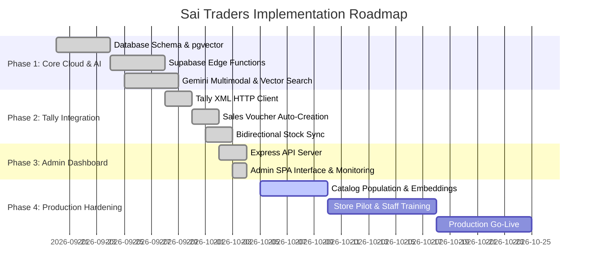

# Implementation Roadmap — Sai Traders Saree Bot

Milestones, phase tracking, and development roadmap.

---

## 1. Roadmap Overview

---

## 2. Phase Breakdown

### Phase 1: Core Cloud Backend & Multimodal AI Engine `[COMPLETED]`
- [x] Create Supabase PostgreSQL schema with `vector(768)`, `customers`, `orders`, `conversations`, `saree_catalog`.
- [x] Configure HNSW vector cosine indexing for sub-second similarity lookups.
- [x] Implement Supabase Edge Function `whatsapp-webhook` with Meta Graph API v21.0 integration.
- [x] Integrate Google Gemini 2.5 Flash for vision attribute extraction and `text-embedding-004` for vectors.
- [x] Implement conversation state machine (`idle` -> `analyzing` -> `results` -> `ordering` -> `placed`).

### Phase 2: Autonomous TallyPrime ERP Agent `[COMPLETED]`
- [x] Build local Node.js agent (`agent/index.js`) listening to Supabase orders.
- [x] Implement XML parser and HTTP client for TallyPrime running on port `9000`.
- [x] Build automated Sales Voucher creation with customer ledger creation and GST allocations.
- [x] Implement periodic stock summary sync to decrement sold inventory from Supabase catalog.

### Phase 3: Admin Web Dashboard & Health Monitoring `[COMPLETED]`
- [x] Develop Express backend (`admin/server.js`) on port 3000.
- [x] Build responsive SPA (`admin/public/`) with system health monitoring tiles.
- [x] Create Saree Catalog manager with photo previews and price/stock editing.
- [x] Add real-time Order Tracker with status transitions and Tally sync indicators.
- [x] Build Image Analysis Log for inspection of customer query photos.

### Phase 4: Catalog Population & Operational Go-Live `[IN PROGRESS]`
- [ ] Bulk ingest physical store saree inventory into `saree_catalog` with high-resolution imagery.
- [ ] Generate batch embeddings for all imported sarees (`scripts/populate_catalog_embeddings.js`).
- [ ] Run end-to-end integration test (`npm test` and `npm run check-env`).
- [ ] Configure live Meta WhatsApp Business webhook URL in Meta App Dashboard.
- [ ] Conduct live store checkout pilot with Sai Traders staff.

### Phase 5: Future Enhancements `[PLANNED]`
- [ ] Integration with Razorpay / UPI dynamic QR codes for in-chat payment links.
- [ ] Multilingual bot support (Kannada and Telugu conversational models).
- [ ] Automated shipping label generation with delivery partners (Delhivery/Shiprocket).
