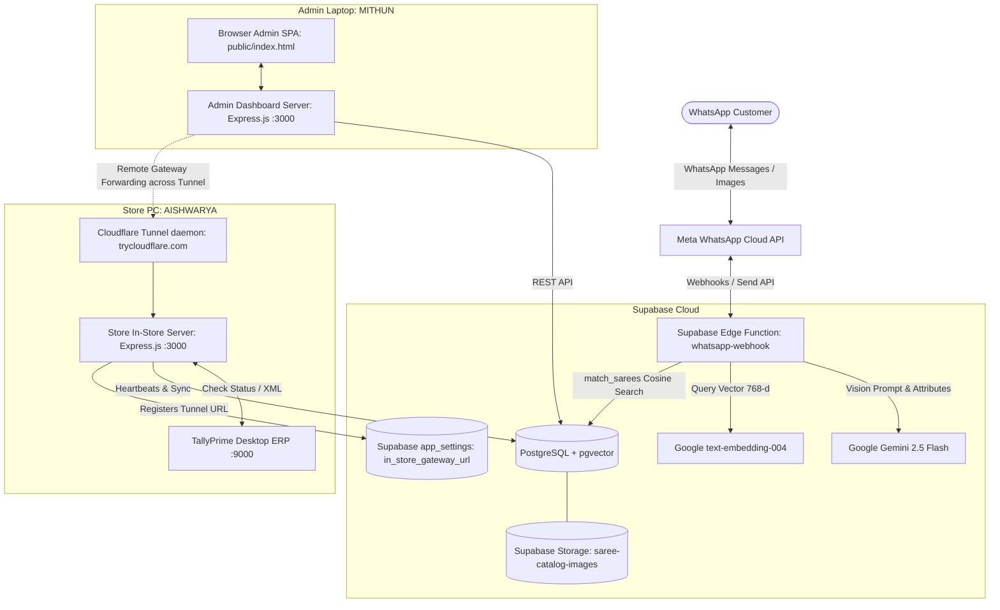

# System Architecture — Sai Traders Saree Bot

High-level architecture, data flows, and component interactions across cloud serverless edge handlers and local desktop services.

---

## 1. Architectural Overview

The Sai Traders system uses a **Hybrid Cloud-Edge & Local-Agent** pattern:

---

## 2. Core Subsystems

### A. WhatsApp Ingress & Conversation State Engine
- **Entrypoint**: `supabase/functions/whatsapp-webhook/index.ts`
- **State Machine**:
  - `idle`: Awaiting customer action; handles greetings, general queries, or photo submissions.
  - `analyzing_image`: Customer submits saree photo → edge function downloads media from Meta CDN → passes buffer to Gemini Vision → extracts attributes → computes embedding → calls `match_sarees()` SQL function → returns top 2-3 interactive WhatsApp cards.
  - `browsing`: Customer asks natural language query (e.g. "show green Kanjivaram under 10k") → generates query embedding → searches vector space.
  - `showing_results`: Displays product cards with images, pricing, and "Select Saree" quick action buttons.
  - `collecting_address`: Customer confirms selection → prompt for shipping address.
  - `order_placed`: Order record created (`SAI-XXXX`) with line items, address, status `pending`, and tracking instructions.

### B. Admin Web Application
- **Backend**: `admin/server.js` (Express.js on port 3000)
- **Frontend**: `admin/public/` (Single Page Application, Vanilla JS, CSS)
- **Capabilities**:
  - Live system connectivity monitor (WhatsApp API, Supabase, Gemini, TallyPrime).
  - Saree Catalog management (CRUD, multi-photo batch uploads, primary cover photo designation, live thumbnail galleries, auto vector embedding trigger).
  - Multi-Godown Tally Inwarding & Discovery (dynamic registry of Tally godowns: `Main Location`, `Online`, `Online_saree`, `Sarees`, with Supabase cloud cache fallback).
  - Real-time Order Tracker with status transitions (`pending`, `confirmed`, `packed`, `shipped`, `delivered`).
  - Image Analysis Log displaying every AI classification query and extracted tags.
  - Manual triggers for Tally inventory reconciliation and voucher generation.

### C. Autonomous Tally Inventory Agent
- **File**: `agent/index.js`
- **Polling Loop (5000ms default)**:
  - Queries Supabase for orders missing `TALLY_SYNCED` in notes.
  - For each item, generates Tally XML Sales Voucher with proper ledger entries (Customer Sundry Debtor, Sales Account, CGST, SGST).
  - Pushes XML to Tally HTTP endpoint (`127.0.0.1:9000`).
  - Updates order status in Supabase to `confirmed` and appends sync voucher confirmation.
- **Stock Sync Loop (30000ms default)**:
  - Queries Tally's `Stock Summary` via XML export.
  - Compares closing stock quantities against `saree_catalog.stock_quantity`.
  - Updates Supabase catalog so out-of-stock items are not recommended by the bot.
