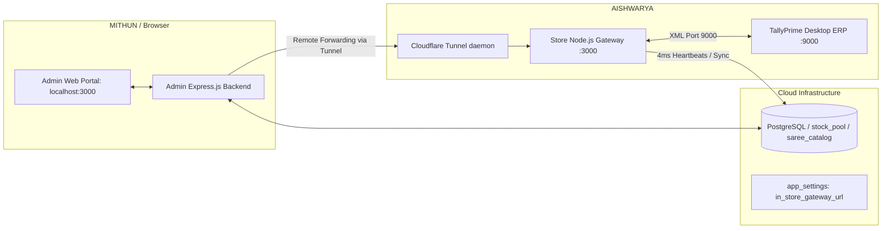

# TallyPrime Initial Setup & Configuration Guide
**Sai Traders Multi-Node ERP & Cloud Synchronization System**
*Revision: 2026-11-01*

---

## Executive Summary

The Sai Traders architecture connects an **Admin Management Laptop** (or Cloud Web Portal) to a physical **Store PC** running **TallyPrime ERP**. This guide details the complete, step-by-step setup required to prepare a fresh TallyPrime installation for automated 24/7 bidirectional stock synchronization, order processing, and isolated inventory management.

---

## 1. System Architecture & Network Topology



- **Admin Laptop (`MITHUN`)**: Where catalog entries, photo uploads, and management occur.
- **Store PC (`AISHWARYA`)**: The machine physically connected to TallyPrime ERP on port 9000.
- **Remote Gateway Forwarding**: When the Admin Laptop detects that local port 9000 is inactive (`isTallyLocallyConnected: false`), it automatically routes stock inwarding, voucher generation, and reconciliation requests across the Cloudflare tunnel (`trycloudflare.com`) to the Store PC.

---

## 2. Step 1: TallyPrime Server Configuration (`tally.ini`)

By default, TallyPrime disables its background XML HTTP server (`Client Server=None`). In this state, any external program attempting to talk to port 9000 is immediately rejected by Windows with `connect ECONNREFUSED 127.0.0.1:9000`.

### Procedure:
1. Completely close **TallyPrime**.
2. Open Windows Notepad as **Administrator**.
3. Open the configuration file located at:
   ```text
   C:\Program Files\TallyPrime\tally.ini
   ```
   *(or the installation directory where `tally.exe` is installed, e.g. `C:\TallyPrime\tally.ini`)*.
4. Locate the section under `[Server]` or `Server Configuration` and ensure the following keys are set:
   ```ini
   Client Server=Both
   ServerPort=9000
   Enable ODBC Server=Yes
   ```
5. Save the file and restart **TallyPrime**.
6. Verify port 9000 is listening by opening PowerShell and running:
   ```powershell
   Test-NetConnection -ComputerName 127.0.0.1 -Port 9000
   ```
   *Expected Output: `TcpTestSucceeded : True`*

---

## 3. Step 2: Company Features Configuration (`F11`)

Load your company (e.g., **`MIithun`**) in TallyPrime. Ensure the inventory and multi-location features are active:

1. From **Gateway of Tally**, press **`F11`** (**Company Features**).
2. Set the following options:
   - **Maintain Accounts:** `Yes`
   - **Enable Bill-wise entry:** `Yes`
   - **Maintain Inventory:** `Yes`
   - **Integrate Accounts with Inventory:** `Yes`
   - **Enable Godowns / Locations:** `Yes` *(Crucial for physical stock isolation)*
   - **Enable Batches:** `Yes` *(Recommended for batch allocations)*
3. Press **`Ctrl + A`** to save features.

---

## 4. Step 3: Mandatory Master Setup (The Big Four)

Before pushing catalog items from the web portal, the following masters must be configured in TallyPrime:

### Master 1: Dedicated Godown (`Online_saree`)
To isolate online website/WhatsApp sales from physical walk-in customer stock, all online items are stored in a dedicated godown.

1. **Gateway of Tally** ➔ **Create** ➔ **Godown** (or Locations).
2. If prompted *"Main Location already exists, do you want to create new?"*, select **Create New**.
3. Fill in:
   - **Name:** `Online_saree`
   - **Under:** `Primary` *(Root level; do NOT place under Main Location)*
4. Press **`Ctrl + A`** to save.

---

### Master 2: Stock Group (`Sarees`)
1. **Gateway of Tally** ➔ **Create** ➔ **Stock Group**.
2. Fill in:
   - **Name:** `Sarees`
   - **Under:** `Primary`
   - **Should quantities of items be added?** `Yes`
3. Press **`Ctrl + A`** to save.

> [!NOTE]
> In Tally XML, `Primary` is the root group. The system XML templates omit `<PARENT>Primary</PARENT>` to ensure Tally does not look for an external group named "Primary".

---

### Master 3: Units of Measure (`Pcs` & `Nos`)
1. **Gateway of Tally** ➔ **Create** ➔ **Unit**.
2. Unit 1:
   - **Symbol:** `Pcs`
   - **Formal Name:** `Pieces`
   - **Number of decimal places:** `0`
3. Unit 2:
   - **Symbol:** `Nos`
   - **Formal Name:** `Numbers`
   - **Number of decimal places:** `0`
4. Press **`Ctrl + A`** to save.

---

### Master 4: Accounting Ledger (`Sales Account`)
When reducing stock in the admin portal (or when online customer orders are confirmed), Tally generates an inventory Sales Voucher. Tally requires a destination accounting ledger for sales.

1. **Gateway of Tally** ➔ **Create** ➔ **Ledger**.
2. Fill in:
   - **Name:** `Sales Account`
   - **Under:** `Sales Accounts`
   - **Inventory values are affected?** `Yes`
3. Press **`Ctrl + A`** to save.

> [!IMPORTANT]
> If `Sales Account` is missing, any stock deduction or sales sync will be rejected by Tally with `<LINEERROR>Ledger 'Sales Account' does not exist!</LINEERROR>`, causing stock adjustments to fail or revert.

---

## 5. Step 4: Understanding & Resolving Tally Exceptions (`Alt + Y`)

In modern TallyPrime (releases 3.0, 4.0, 5.0+), when an XML import contains a validation issue (such as referencing an uncreated group or ledger), **Tally does not discard the master**. Instead, it quarantines the master in its internal **`All Exceptions`** holding buffer.

### Symptoms of Quarantined Exceptions:
1. **Error on manual creation:** *"Oops! A master with same name exists as an exception."*
2. **Stock Reverts to Zero:** The quarantined item appears in Tally's item collection with `0` balance. The background cloud reconciler reads `0` from Tally and updates the web catalog to `0` ("Out of Stock").

### How to Clear Quarantined Exceptions:
1. In TallyPrime, press **`Alt + Y`** (or click **Data** on the top blue ribbon).
2. Look at **All Exceptions**:
   - If **`All Exceptions` is clickable**: There are quarantined exceptions holding up your masters.
   - If **`All Exceptions` is disabled / greyed out**: The queue is completely clean (0 exceptions).
3. If clickable:
   - Press **`Enter`** on **All Exceptions** ➔ select **Import**.
   - Drill down into **Master-Related Exceptions** ➔ **Referenced master is missing** (e.g. `Stock Group`).
   - Press **`Spacebar`** on the quarantined line(s) to highlight/select them.
   - Press **`Alt + D`** (Delete) ➔ confirm **`Yes`** (`Y`).
4. Press **`Esc`** back to Gateway of Tally.
5. In the Admin Portal, click **Push to Tally** or **Update in Tally ERP**.

---

## 6. Step 5: Starting the Store PC Daemon & High-Availability Supervisor

On the Store PC (`AISHWARYA`):

1. Double-click:
   ```text
   c:\sai_traders\store_install\START_STORE_PC.bat
   ```
2. The launcher automatically engages the **Store Supervisor & High-Availability Watchdog** (`scripts/store_supervisor.js`):
   - **Fault-Tolerant Auto-Restart**: If the Node.js operations core or Cloudflare tunnel crashes or gets closed, the supervisor immediately restarts them (after 3s / 5s backoff).
   - **Automatic Log Rotation**: Caps `server.log`, `server_error.log`, and `tunnel.log` at 10MB each (retaining max 3 rolling archives) to prevent hard drive exhaustion on store workstations.
   - **Telemetry Publishing**: Reports memory, uptime, process IDs, and restart counts directly to Supabase (`store_supervisor_telemetry`).
   - **Dynamic URL Discovery**: Launches `cloudflared.exe` and registers the active gateway URL to Supabase `app_settings` (`in_store_gateway_url`).
   - **Heartbeat Engine**: Broadcasts live 4ms health check heartbeats to the cloud.

### Stopping Store Services Cleanly:
To terminate all background store processes (supervisor, operations core on port 3000, and tunnel daemons) cleanly at the end of the day:
```text
c:\sai_traders\store_install\STOP_STORE_PC.bat
```

### Production Setup: Persistent Cloudflare Tunnel (Recommended)
By default, the supervisor spins up an ephemeral Quick Tunnel (`*.trycloudflare.com`). For production stability without URL changes across reboots:
1. Create a named tunnel in your Cloudflare Zero Trust dashboard.
2. Route the tunnel to `http://localhost:3000` with your custom hostname (e.g., `store-gateway.saitraders.in`).
3. Add these two variables to your `.env` on the Store PC:
   ```env
   CLOUDFLARE_TUNNEL_TOKEN=eyJhIjoiY2...your_tunnel_token_here
   CLOUDFLARE_TUNNEL_DOMAIN=https://store-gateway.saitraders.in
   ```
4. When `CLOUDFLARE_TUNNEL_TOKEN` is present, the supervisor executes `cloudflared tunnel run --token <token>` and locks `in_store_gateway_url` to your fixed domain.

### Automatic Windows Boot Setup:
To ensure the Store PC syncs automatically whenever the PC is powered on (even after a reboot or power outage), run:
```text
c:\sai_traders\store_install\AUTO_START_ON_BOOT.bat
```
This places a verified launch shortcut into Windows Startup (`shell:startup`).

---

## 7. Verification & Daily Operating Checks

### From the Admin Web Portal (`http://localhost:3000`):
1. **Tally Connection Dot:** Must show `● Tally Online (Store PC: AISHWARYA)`.
2. **Company:** Must display `MIithun`.
3. **Active Godown:** Must show `Online_saree`.
4. **Catalog Badge:** Items pushed to Tally display `● In Tally` with live unit count.

### From TallyPrime Directly (Store PC):
| Verification Goal | Keypress Sequence from Gateway of Tally |
| :--- | :--- |
| **Check Godown Stock** | `D` (Display More Reports) ➔ `I` (Inventory Books) ➔ `G` (Godowns) ➔ `Online_saree` |
| **Check Stock Summary** | `S` (Stock Summary) ➔ `Alt + F1` (Detailed) |
| **Check Day Book Vouchers** | `K` (Day Book) ➔ Review `Receipt Note` (`RN-ADJ-...`) and `Sales` vouchers |

---

## 8. Troubleshooting Cheat Sheet

| Symptom / Error | Root Cause | Solution |
| :--- | :--- | :--- |
| `connect ECONNREFUSED 127.0.0.1:9000` | `Client Server=None` in `tally.ini` or TallyPrime closed | Edit `tally.ini` to `Client Server=Both`, `ServerPort=9000`, restart Tally |
| `Stock Group 'Sarees' does not exist` | Parent group not created before product push | Create Stock Group `Sarees` (Under: `Primary`) in Tally |
| `Ledger 'Sales Account' does not exist` | Missing sales account for stock deduction / sales voucher | Create Ledger `Sales Account` (Under: `Sales Accounts`) in Tally |
| `A master with same name exists as an exception` | Previous failed import quarantined in Tally holding buffer | `Alt + Y` ➔ `All Exceptions` ➔ Drill down ➔ `Alt + D` to delete |
| Stock updates in UI but immediately falls back to zero | Quarantined item reported 0 to reconciler, or remote forwarding was offline | Clear Tally exceptions; ensure `START_STORE_PC.bat` is active |
| Offline in Admin UI while Store PC is on | Cloudflare tunnel refreshed or laptop on separate LAN | Confirm Store PC displays green tunnel in terminal; check `app_settings` |
