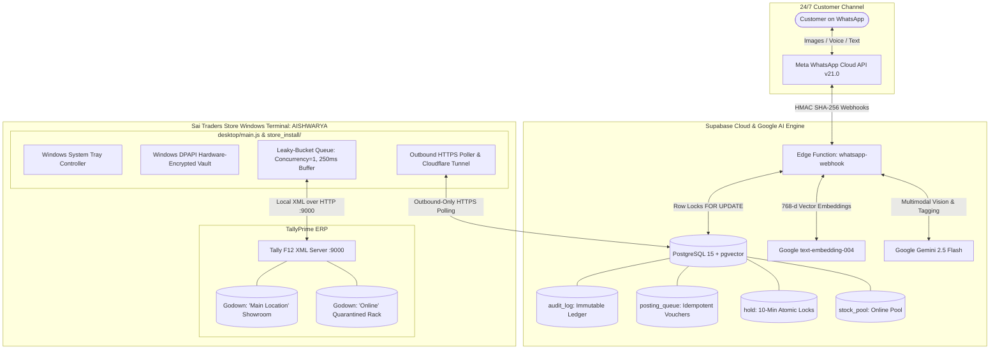
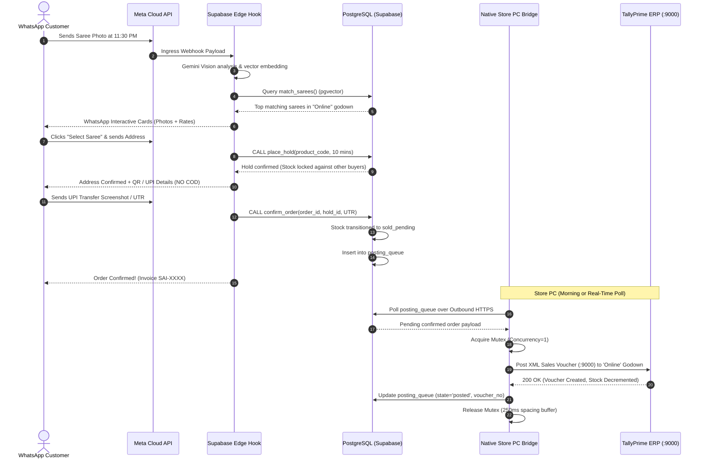

# Sai Traders — Bank-Grade In-Store Bridge & 24/7 WhatsApp AI Commerce Specification
**System Classification**: Enterprise Textile Retail & ERP Synchronous Bridge  
**Target Environment**: Windows 10/11 POS Machine (Store PC) · TallyPrime ERP · Supabase PostgreSQL + pgvector · Meta WhatsApp Cloud API · Google Gemini 2.5 Flash Vision  
**Document Status**: Comprehensive Execution Blueprint & Architecture Specification  
**Date**: November 1, 2026  

---

## 1. Executive Summary & Vision

### 1.1 The Business Paradigm
**Sai Traders** (Tumakuru, Karnataka) operates a high-volume physical showroom and wholesale saree business. The objective of this architecture is to build a **"Shopify-like, Bank-Grade Protected Commerce Platform"** tailored for traditional Indian textile retail. 

The system solves the four classical points of failure in brick-and-mortar retail digitalization:
1. **The In-Store ERP Isolation Barrier**: TallyPrime ERP runs on an in-store Windows billing PC behind a commercial router with closed ports, dynamic IP, and strict firewall rules. Cloud servers cannot reach it directly.
2. **The 24/7 Conversational Commerce Need**: High-value saree purchases are visual and emotional. Customers want to send photos from Instagram, Pinterest, or weddings at any hour and receive instant, live-stock recommendations.
3. **The Risk of Theft & Cash Pilferage (NO COD Policy)**: Cash on Delivery (COD) in high-ticket apparel leads to cash theft, bill amount tampering by delivery agents, and rejected shipments that lock up inventory.
4. **The Inventory Collision Problem (Showroom vs. Online)**: Walk-in customers in Tumakuru cannot be allowed to buy the exact single-piece bridal saree that an online customer just purchased via WhatsApp.

---

## 2. High-Level System Architecture



---

## 3. Subsystem 1: In-Store Native Windows Desktop Bridge

### 3.1 Why Direct Cloud-to-Port-9000 is Impossible & Dangerous
* **Network Reality**: TallyPrime listens strictly on `http://127.0.0.1:9000` on the local Windows PC. The store PC is behind residential/commercial NAT, ISP Carrier-Grade NAT (CGNAT), and dynamic IP allocations. A cloud server in Frankfurt or Mumbai cannot initiate a TCP handshake to `127.0.0.1:9000`.
* **Security Threat of Port Forwarding**: Exposing port 9000 to the public internet via router port-forwarding is catastrophic: Tally's XML engine has **zero built-in authentication**, no SSL/TLS encryption, and accepts plain text XML envelopes that can overwrite company balances, ledgers, and financial journals.

### 3.2 The Native Bridge Architecture
To eliminate these vulnerabilities, a native Windows Desktop application runs locally on the store PC:
* **Codebase Locations**:
  * Core Controller: [`desktop/main.js`](file:///c:/sai_traders/desktop/main.js)
  * Cashier Native Tool UI: [`desktop/bridge-ui.html`](file:///c:/sai_traders/desktop/bridge-ui.html)
  * Turnkey Store Distribution Kit: [`store_install/`](file:///c:/sai_traders/store_install/)
  * Background Polling Engine: [`agent/index.js`](file:///c:/sai_traders/agent/index.js) & [`agent/poller.js`](file:///c:/sai_traders/agent/poller.js)

### 3.3 Key Technical Safeguards
1. **Outbound-Only Network Model**:
   * The bridge initiates all connections **outbound** over TLS 1.3 (HTTPS) to Supabase and the encrypted Cloudflare tunnel (`scripts/cloudflared.exe`).
   * **Zero incoming listening ports** are opened on the store router or Windows firewall.
2. **Hardware-Encrypted Credential Vault (Windows DPAPI)**:
   * Uses Electron’s `safeStorage` API backed by the **Windows Data Protection API (DPAPI)**.
   * Encryption keys are tied directly to the Windows user account and hardware TPM chip.
   * Even if the `.env` file is accidentally exposed or read, decrypted master tokens cannot be extracted from another computer.
3. **Non-Intrusive System Tray Operation**:
   * Minimizes to the Windows System Tray (Notification Area) with live status tooltips:
     `Sai Traders Bridge — Tally: Active (4ms latency) | Godown: Online`
   * Does not clutter the retail cashier’s screen or interfere with physical barcode scanners.
   * Auto-starts on Windows boot via `app.setLoginItemSettings({ openAtLogin: true })`.
4. **Leaky-Bucket Queue Manager (`TallyQueueManager`)**:
   * TallyPrime operates on a single-threaded XML engine. Multiple simultaneous requests will crash or lock the ERP.
   * The bridge enforces **Strict Concurrency = 1** with an enforced **250ms spacing buffer** between consecutive XML envelopes, ensuring 100% stability even during flash sales.
5. **Cryptographic Identity Verification & Company GUID Binding**:
   * Every 3 seconds, the bridge validates Tally’s internal `Company GUID` (`/api/bridge-telemetry`).
   * If an employee accidentally switches companies in Tally to a personal test file, the bridge instantly halts syncing and alerts the cloud, preventing data corruption.

---

## 4. Subsystem 2: 24/7 Autonomous WhatsApp AI Sales Engine

### 4.1 Continuous Visual Commerce
* **Webhook Entrypoint**: [`supabase/functions/whatsapp-webhook/index.ts`](file:///c:/sai_traders/supabase/functions/whatsapp-webhook/index.ts)
* **Round-the-Clock Availability**: Runs serverless on Supabase Edge globally distributed infrastructure, answering customer inquiries at 2:00 AM without staff presence.

### 4.2 Multimodal Visual Discovery Pipeline
1. **Customer Image Submission**: Customer sends a screenshot or camera photo of a saree.
2. **Gemini 2.5 Flash Extraction**: The image buffer is streamed to Google Gemini Vision (`_shared/gemini.ts`), which analyzes:
   * Primary & secondary color palettes (e.g. *Peacock Blue with Mustard Zari*).
   * Fabric category (*Pure Kanjivaram Silk, Banarasi, Organza, Chiffon*).
   * Border & pallu styling (*Temple border, Floral jaal, Korvai weave*).
   * Occasion tagging (*Bridal, Reception, Festival, Daily Wear*).
3. **Vector Similarity Matching (pgvector)**:
   * Visual attributes are converted to a 768-dimensional embedding via `text-embedding-004`.
   * A cosine-distance HNSW index query executes via the PostgreSQL stored function `match_sarees()`:
     ```sql
     SELECT id, name, sku, price, stock_quantity, 1 - (embedding <=> query_embedding) AS similarity
     FROM saree_catalog
     WHERE is_listed = true AND stock_quantity > 0
     ORDER BY embedding <=> query_embedding
     LIMIT 3;
     ```
4. **Conversational Checkout Flow**:
   * Displays interactive WhatsApp cards with product image, pricing, and material specifications.
   * Collects customer full name, delivery address, and pincode via conversational state machine (`idle` → `analyzing_image` → `browsing` → `collecting_address` → `awaiting_payment`).

---

## 5. Subsystem 3: Bank-Grade Anti-Theft & Fraud Protection (Strictly NO COD)

### 5.1 The Vulnerability of Cash on Delivery (COD) in Retail Textiles
In traditional Indian saree trade, COD introduces severe financial and inventory leakages:
* **Courier Cash Pilferage**: Delivery boys or third-party logistics agents skimming cash payments or reporting false transit losses.
* **Amount Alteration Fraud**: Manipulation of manual cash memo amounts at delivery points.
* **Inventory Freezing (RTO Fraud)**: Customers ordering on whim; sarees remain in transit for 7–10 days before returning as "Refused at Doorstep", depriving the physical store of selling high-demand bridal pieces.

### 5.2 Strict Prepaid Policy Enforcement
In [`whatsapp-webhook/index.ts#L844-L852`](file:///c:/sai_traders/supabase/functions/whatsapp-webhook/index.ts#L844-L852), COD is explicitly blocked:
```typescript
const paymentMsg =
  `📍 *Delivery Address Confirmed:*\n` +
  `👤 *Name:* ${finalName}\n` +
  `🏠 *Address:* ${finalAddress.street || finalAddress.full_address}\n\n` +
  `━━━━━━━━━━━━━━━━━━━━━━\n` +
  `💳 *Order Checkout — Step 2 of 2: UPI / QR Payment*\n` +
  `*(Note: Cash on Delivery is NOT available. 100% Prepaid Safe Dispatch)*\n\n` +
  `🥻 *Saree:* ${saree.name}\n` +
  `💰 *Total Amount Payable:* *₹${saree.price.toLocaleString("en-IN")}*\n\n` +
  `📲 *Pay via UPI:*\n` +
  `• *UPI ID:* saitraders@upi\n` +
  `• *Google Pay / PhonePe / Paytm:* +91 98765 43210\n` +
  `• *Beneficiary:* Sai Traders\n\n` +
  `👉 After transferring ₹${saree.price.toLocaleString("en-IN")}, please reply with your Transaction ID / UTR Number (or send a payment receipt screenshot) to confirm your order!`;
```

### 5.3 Technical Anti-Tampering Protections
1. **Immutable Server Pricing**: Unit prices and GST calculations are pulled strictly from the database catalog table. No client application or webhook input can alter the payable price.
2. **Cryptographic UTR & Transaction Association**: The customer’s transaction UTR or payment screenshot ID is tied immutably to the order record in `orders.notes` (`PREPAID_UPI | Ref: <UTR_NUMBER>`).
3. **Idempotent ERP Sales Vouchers**:
   * Every confirmed order generates a unique, deterministic `REMOTEID` and `VOUCHERKEY` (`SAI-ORD-<TIMESTAMP>-<ID>`).
   * When pushed to Tally ERP, Tally checks for existing `REMOTEID`. If a network glitch causes a retry, Tally recognizes the voucher as already created, **completely preventing duplicate sales invoices or duplicate inventory deductions**.

---

## 6. Subsystem 4: Godown Isolation (Showroom vs. Online Sales)

### 6.1 The Double-Selling Problem
A physical store in Tumakuru cannot operate like a dropshipping site. If a walk-in customer is examining a single-edition Kanjivaram silk saree on the counter, and an online customer completes payment on WhatsApp for that exact saree, one customer will be denied their order.

### 6.2 The Dual-Layer Isolation Solution
The architecture implements both physical and accounting separation:

#### A. Physical Separation (Store Quarantined Rack)
* All sarees listed for online WhatsApp sales are physically segregated into a dedicated, numbered rack in the shop marked **"Online Stock"**.
* Showroom counter staff do not draw sarees from this rack for regular walk-in customers.

#### B. Accounting & ERP Separation (Tally "Online" Godown)
* In TallyPrime ERP, inventory is tracked across distinct Godowns:
  * **`Main Location`**: Physical showroom stock for walk-in counter sales.
  * **`Online`**: Dedicated e-commerce godown reserved strictly for cloud sales.
* When the in-store cashier bills a walk-in customer, Tally deducts stock from `Main Location`.
* When the WhatsApp bot bills an online order, the generated XML Sales Voucher explicitly deducts from the `Online` godown:
  ```xml
  <ALLINVENTORYENTRIES.LIST>
      <STOCKITEMNAME>Pure Kanjivaram Silk Saree</STOCKITEMNAME>
      <ISDEEMEDPOSITIVE>No</ISDEEMEDPOSITIVE>
      <RATE>12500.00/Pcs</RATE>
      <AMOUNT>12500.00</AMOUNT>
      <BATCHALLOCATIONS.LIST>
          <GODOWNNAME>Online</GODOWNNAME>
          <BATCHNAME>Primary Batch</BATCHNAME>
          <ACTUALQTY>-1 Pcs</ACTUALQTY>
          <BILLEDQTY>-1 Pcs</BILLEDQTY>
      </BATCHALLOCATIONS.LIST>
  </ALLINVENTORYENTRIES.LIST>
  ```

#### C. Database Atomic 2-Phase Concurrency Control (`stock_pool` & `hold`)
Defined in [`supabase/migrations/20261016223000_stock_sync_system_phase1.sql`](file:///c:/sai_traders/supabase/migrations/20261016223000_stock_sync_system_phase1.sql):
1. **Hold Creation (`place_hold`)**:
   * When a customer initiates checkout, the database executes an atomic `SELECT ... FOR UPDATE` lock on `stock_pool`.
   * It increments `held_quantity` and reserves the piece for **10 minutes** (`expires_at = now() + interval '10 minutes'`).
   * No other customer on WhatsApp or Web can check out that piece while held.
2. **Order Confirmation (`confirm_order`)**:
   * Upon receipt of verified UPI payment proof, `confirm_order()` atomically moves the stock from `held_quantity` to `sold_pending_quantity` and queues the Tally posting job in `posting_queue`.
3. **Expired Hold Release (`release_hold`)**:
   * If the customer does not complete payment within 10 minutes, the background release cron frees the hold back to `available_quantity` without manual human intervention.
4. **Daily Morning Reconciliation (`apply_sync_result`)**:
   * Every morning at 09:30 AM, the in-store agent runs `read_godown_balances('Online')`.
   * It extracts the exact closing balance from Tally and compares it with Supabase `stock_pool.online_quantity`.
   * Any variances (e.g. if the owner manually re-allocated stock) are flagged in the `discrepancies` table for audit sign-off.

---

## 7. Operational Workflow & Execution Blueprint



---

## 8. Verification & Audit Trail Matrix

| Requirement | Codebase Implementation | Verification Method |
|:---|:---|:---|
| **Port 9000 Bridge** | [`desktop/main.js`](file:///c:/sai_traders/desktop/main.js), [`agent/tally_client.js`](file:///c:/sai_traders/agent/tally_client.js) | Run `scripts/test_tally_ping.js` or `store_install/TEST_TALLY_CONNECTION.bat` |
| **Outbound Only / Zero Open Ports** | [`agent/index.js#L5-L9`](file:///c:/sai_traders/agent/index.js#L5-L9) | Netstat check: verifies no external ports listening on Store PC |
| **Hardware DPAPI Encryption** | [`desktop/main.js#L32-L66`](file:///c:/sai_traders/desktop/main.js#L32-L66) | Inspect `bridge_vault.bin` via DPAPI safeStorage |
| **Leaky-Bucket Rate Limiter** | [`agent/tally_queue.js`](file:///c:/sai_traders/agent/tally_queue.js), [`admin/server.js#L3752`](file:///c:/sai_traders/admin/server.js#L3752) | Concurrency benchmark: 10 parallel requests spaced by 250ms |
| **24/7 AI Multimodal Search** | [`supabase/functions/whatsapp-webhook/index.ts`](file:///c:/sai_traders/supabase/functions/whatsapp-webhook/index.ts) | Send saree photo to WhatsApp bot test number |
| **Strictly NO COD Policy** | [`whatsapp-webhook/index.ts#L844-L852`](file:///c:/sai_traders/supabase/functions/whatsapp-webhook/index.ts#L844-L852) | Inspect interactive checkout message copy and order table constraints |
| **Anti-Theft / Immutable Pricing** | [`whatsapp-webhook/index.ts#L888-L925`](file:///c:/sai_traders/supabase/functions/whatsapp-webhook/index.ts#L888-L925) | Verify server-side price lookup before order insertion |
| **Godown Isolation ("Online")** | [`supabase/migrations/20261016223000_stock_sync_system_phase1.sql`](file:///c:/sai_traders/supabase/migrations/20261016223000_stock_sync_system_phase1.sql) | Verify XML payload contains `<GODOWNNAME>Online</GODOWNNAME>` |
| **Atomic Concurrency (Zero Double-Booking)** | Stored procedures `place_hold`, `confirm_order`, `release_hold` | Run `scripts/test_stock_functions_and_concurrency.js` |
| **Morning Inventory Reconciliation** | Stored procedure `apply_sync_result`, [`agent/jobs/read_godown.js`](file:///c:/sai_traders/agent/jobs/read_godown.js) | Run preflight sync job and verify `discrepancies` audit table |

---

## 9. Next Steps for Production Rollout

1. **Store PC Setup**:
   - Copy [`store_install/`](file:///c:/sai_traders/store_install/) to `C:\sai_traders_store\` on the Store PC.
   - Execute `TEST_TALLY_CONNECTION.bat` to confirm TallyPrime is listening on port 9000 with ODBC/XML enabled.
   - Double-click `START_BRIDGE_APP.bat` to launch the native desktop tray agent.
2. **Tally Godown Creation**:
   - In TallyPrime, create the Godown named **`Online`** under `Primary`.
   - Transfer online saree catalog stock from `Main Location` to `Online` via Tally Stock Journal.
3. **Webhook Production Binding**:
   - Point the Meta Developer WhatsApp Webhook URL to the production Supabase Edge Function (`https://<project-ref>.supabase.co/functions/v1/whatsapp-webhook`).
4. **Live Verification**:
   - Execute a simulated end-to-end checkout with a test UPI transaction and observe real-time deduction in Tally's `Online` godown.
